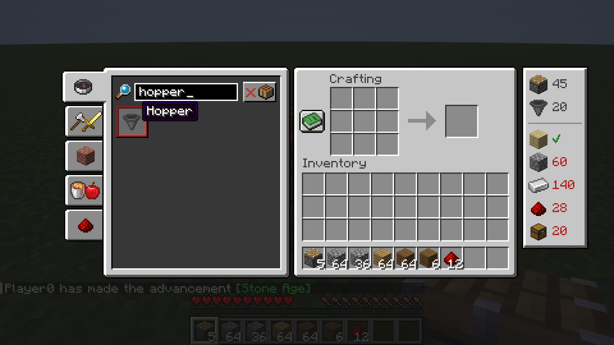

# Recipe Planner

Stop doing math for your farms. Tell Recipe Planner what you want to build, and it shows exactly which ingredients you still need.



## How it works

- **Add things to build:** right-click a recipe in the recipe book (crafting table or inventory). Each right-click adds one; **Shift + right-click** adds 10.
- **Recipes with variants** (planks, beds, wool …): right-click opens the vanilla variant picker, then right-click the variant you want.
- **The list** sits next to your inventory. The top part shows what you want to craft, below the line are the ingredients:
  - **red number** = how many are still missing
  - **green ✔** = you have enough
  - hover for details, like "Still missing: 160 (2 stacks + 32)"
- **Counts your inventory and the open chest.** Open a chest and the numbers update instantly.
- Items you already crafted are subtracted automatically.
- In the list: **left-click +1, right-click −1**, hold Shift for ±10. At 0 the entry is removed.
- Only recipes you have **unlocked** show up, so it works fine in survival and on servers.
- If there is not enough room next to the window (high GUI scale, recipe book open), the list switches to a compact column with the numbers on the icons.

## Details

- **Client-side only.** Works on any server, the server does not need the mod.
- Shows **direct ingredients** (what goes into the crafting grid). Crafting table recipes are preferred, stonecutter and furnace recipes are used if there is nothing else.
- The list is saved in `config/recipeplanner.json` and shared between all worlds.
- Languages: English, German.

## Requirements

- Minecraft 26.3
- Fabric Loader 0.19.5 or newer
- Fabric API

## Building

```
./gradlew build
```

The mod jar ends up in `build/libs/`. `./gradlew runClient` starts a test game, `./gradlew runClientGameTest` runs the automated in-game test.

## License

MIT, see [LICENSE](LICENSE).
